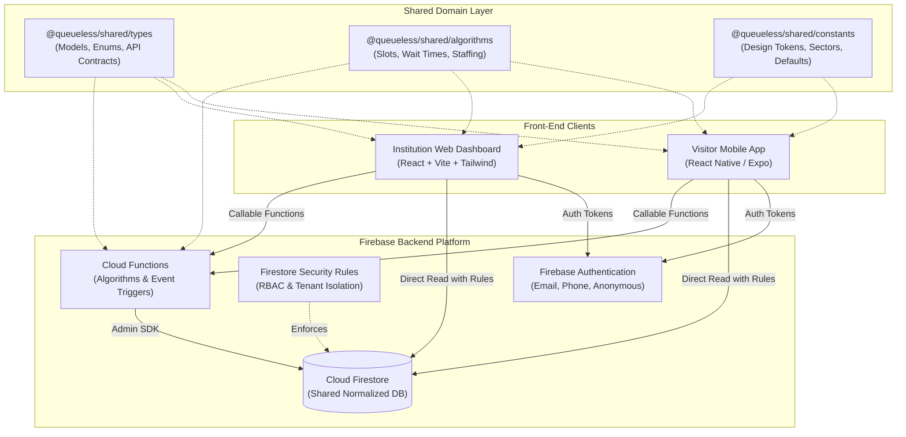

# QueueLess System Architecture

**Document Version:** 1.0.0  
**Architectural Tier:** Multi-Tenant Distributed Queue and Crowd Intelligence Platform  

---

## 1. Executive Summary

QueueLess eliminates physical waiting lines, mitigates overcrowding hazards, and optimizes operational counter throughput across multi-sector institutions (Hospitals, Banks, Universities, Government Centers, and Public Utilities).

The platform coordinates two client experiences:
1. **Visitor Mobile App (Android/Expo React Native):** Discovery, token booking, smart arrival slot notifications, live position tracking, and QR check-in.
2. **Institution Admin Dashboard (React + Vite + Tailwind CSS):** Branch/department/counter configuration, live queue dispatching, zone crowd heatmaps, overcrowding warnings, and dynamic staffing recommendations.

Both applications communicate with a unified Google Cloud Firestore database and Cloud Functions backend governed by strict multi-tenant security rules.

---

## 2. High-Level Architectural Diagram



---

## 3. Four-Member Team Ownership Matrix

The project structure cleanly establishes boundaries for four independent developers while enforcing contract compliance:

| Member | Primary Role | Owned Directories | Key Responsibilities |
| :--- | :--- | :--- | :--- |
| **Member 1** | Mobile Developer | `mobile/` | Visitor UI, institution discovery, token booking, live queue ticker, camera QR scanner, Expo push notifications. |
| **Member 2** | Admin Dashboard Developer | `admin/` | Institution/branch/counter management, token queue dispatching, crowd density heatmap, analytics charts. |
| **Member 3** | Backend Engineer | `firebase/` | Firebase Auth, Firestore indexes, security rules, Cloud Functions implementation, audit logging. |
| **Member 4** | Algorithms & QA Engineer | `shared/algorithms/`, `tests/` | Smart arrival slot calculations, wait-time estimation, crowd density thresholds, staffing recommender, automated unit/integration tests. |

---

## 4. Multi-Sector Extensibility Pattern

To prevent sector bias (such as making the system hospital-only or bank-only), QueueLess uses an abstract organizational taxonomy:

```
Institution (e.g. City General Hospital / First National Bank)
  └── Branch (e.g. Downtown Campus / North Branch)
        ├── Zone (Physical waiting area, e.g. "Main Waiting Lounge", Capacity: 100)
        ├── Department (e.g. "Cardiology" / "Teller Services")
        │     ├── Service (e.g. "ECG Test" / "Cash Withdrawal")
        │     └── Counter (e.g. "Counter 1" / "Window B")
        └── Staff (Assigned to department & counter with specific service skills)
```

Pre-configured sector presets (`SECTOR_PRESETS`) are defined in `@queueless/shared/constants/sectors.ts` for quick onboarding of:
- **Healthcare:** Clinics, hospitals, diagnostic labs.
- **Banking:** Retail banks, loan desks, forex windows.
- **Education:** Registrar, tuition payment, examination cell.
- **Government:** Municipal offices, RTO, passport facilitation.
- **Public Services:** Utilities, post offices, customer centers.

---

## 5. Security & Isolation Strategy

1. **Tenant Isolation:** Every write and query includes `institutionId`. Security rules ensure users can only access records matching their institutional credentials.
2. **Visitor Data Privacy:** Visitors can only read and mutate tokens where `resource.data.visitorId == request.auth.uid`.
3. **No Secret Injections in Frontend:** Client bundles only contain public Firebase configuration. Administrative mutations execute either via Cloud Functions with the Admin SDK or strict security rules with verified custom claims.
