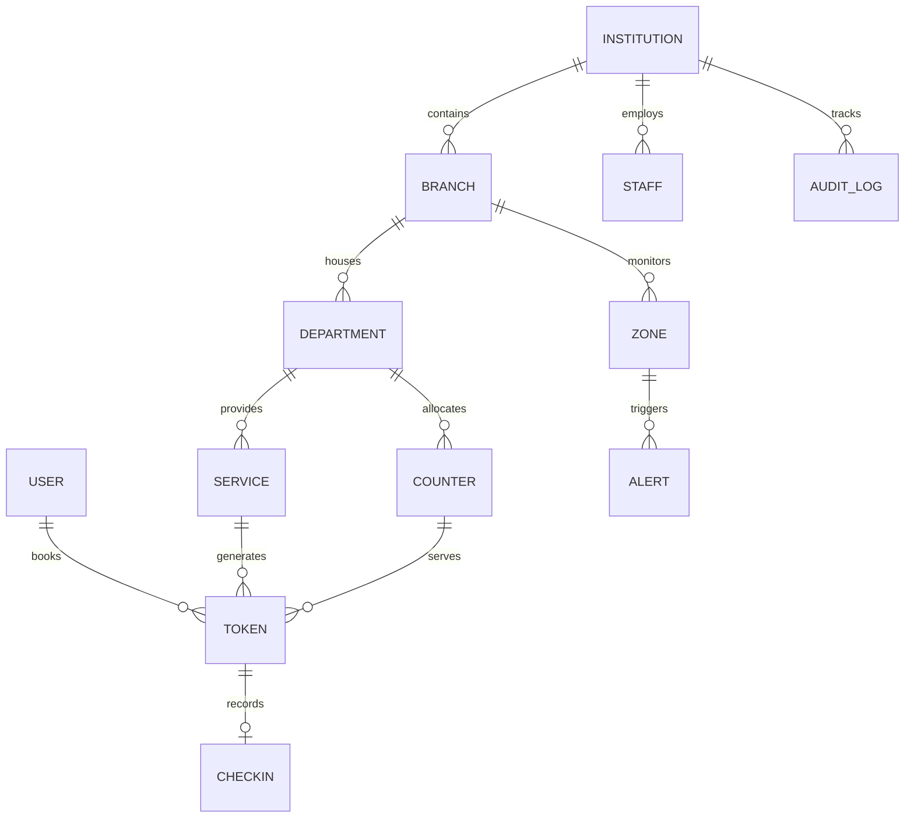

# QueueLess Database Schema Documentation
**Version:** 1.0.0  
**Storage Engine:** Google Cloud Firestore (NoSQL Document Store)  
**Security Model:** Role-Based Access Control (RBAC) & Multi-Tenant Partitioning  

---

## 1. Architectural Principles

1. **Multi-Tenant Isolation:**  
   Every operational entity (`branch`, `department`, `service`, `counter`, `staff`, `token`, `zone`, `checkIn`, `alert`, `auditLog`) carries an immutable `institutionId` and (where applicable) a `branchId`. Firestore Security Rules strictly enforce that administrators and staff can only read and mutate documents within their assigned institution.

2. **Sector-Agnostic Design:**  
   No domain-specific terms (e.g. `patientId`, `doctorNotes`, `accountNumber`) are hardcoded into the base schema. Instead, entities represent universal queuing concepts: *Visitor*, *Institution*, *Service*, *Counter*, *Zone*, and *Token*. Custom metadata is stored in structured dictionary fields (`metadata?: map`).

3. **Denormalization for Query Efficiency:**  
   To prevent complex subquery joins in Firestore, frequent display fields (such as `visitorName`, `counterNumber`, `departmentName`, `serviceName`) are denormalized into the `tokens` collection, allowing high-performance mobile list views and dashboard widgets.

4. **Normalized Collection Architecture:**  
   Top-level root collections with indexed compound filters (`institutionId` + `branchId` + `status` + `createdAt`) are preferred over deep nesting. This avoids Firestore 1-read-per-subcollection limitations and simplifies collection group queries across branches.

---

## 2. Global Entity Relationship Overview

---

## 3. Collection Specifications

### 3.1 `users`
Represents both public visitors and institution staff members.
- **Collection Path:** `/users/{userId}`
- **Primary Key:** `userId` (Firebase Auth UID)

| Field | Type | Required | Description / Allowed Values |
| :--- | :--- | :--- | :--- |
| `userId` | `string` | Yes | Firebase Auth UID |
| `email` | `string` | Yes | Unique user email address |
| `phone` | `string` | No | E.164 formatted telephone number |
| `displayName` | `string` | Yes | User's full name |
| `role` | `string` | Yes | `SUPER_ADMIN`, `INSTITUTION_ADMIN`, `BRANCH_ADMIN`, `DEPARTMENT_MANAGER`, `COUNTER_STAFF`, `SECURITY_STAFF`, `VISITOR` |
| `institutionId` | `string` | No | Present if user is affiliated with an institution (null for `VISITOR`) |
| `branchId` | `string` | No | Present if staff is restricted to a specific branch |
| `assignedCounterId`| `string` | No | Present when counter staff logs into an active desk |
| `avatarUrl` | `string` | No | Profile photo URL |
| `isActive` | `boolean` | Yes | `true` if account is enabled |
| `preferences` | `map` | No | `{ notificationsEnabled: boolean, smsAlertsEnabled: boolean, preferredLanguage: string }` |
| `createdAt` | `string` | Yes | ISO 8601 string |
| `updatedAt` | `string` | Yes | ISO 8601 string |

---

### 3.2 `institutions`
The root enterprise entity for hospitals, banks, colleges, or government hubs.
- **Collection Path:** `/institutions/{institutionId}`
- **Primary Key:** `institutionId`

| Field | Type | Required | Description |
| :--- | :--- | :--- | :--- |
| `institutionId` | `string` | Yes | Unique institution identifier |
| `name` | `string` | Yes | Legal / trade name (e.g. "Apex Healthcare", "Metro Bank") |
| `slug` | `string` | Yes | Unique URL-friendly slug (e.g. "apex-healthcare") |
| `sector` | `string` | Yes | `HEALTHCARE`, `BANKING`, `EDUCATION`, `GOVERNMENT`, `PUBLIC_SERVICES`, `RETAIL_SERVICE`, `OTHER` |
| `logoUrl` | `string` | No | URL to high-resolution logo |
| `description` | `string` | No | Brief overview of services |
| `contactEmail` | `string` | Yes | Institutional primary contact email |
| `contactPhone` | `string` | Yes | Contact helpline number |
| `website` | `string` | No | Official website URL |
| `operatingHours` | `map` | Yes | `{ timezone: string, weeklySchedule: map }` |
| `settings` | `map` | Yes | `{ maxAdvanceBookingDays, allowWalkIns, requireQRCheckIn, autoCallNextToken, defaultSlotDurationMinutes, gracePeriodMinutes, overcrowdingAlertThresholdPercent }` |
| `isActive` | `boolean` | Yes | `true` if active |
| `createdAt` | `string` | Yes | ISO 8601 timestamp |
| `updatedAt` | `string` | Yes | ISO 8601 timestamp |

---

### 3.3 `branches`
Physical facilities or campuses operating under an institution.
- **Collection Path:** `/branches/{branchId}`
- **Primary Key:** `branchId`

| Field | Type | Required | Description |
| :--- | :--- | :--- | :--- |
| `branchId` | `string` | Yes | Unique branch ID |
| `institutionId` | `string` | Yes | Foreign Key -> `institutions.institutionId` |
| `name` | `string` | Yes | Branch title (e.g. "Main City Campus", "West End Branch") |
| `code` | `string` | Yes | Internal code unique to institution (e.g. "MAIN-01") |
| `address` | `map` | Yes | `{ street, city, state, postalCode, country, latitude, longitude }` |
| `contactPhone` | `string` | No | Local branch desk number |
| `operatingHours` | `map` | No | Optional override of institutional hours |
| `isActive` | `boolean` | Yes | Active status |
| `createdAt` | `string` | Yes | ISO 8601 timestamp |
| `updatedAt` | `string` | Yes | ISO 8601 timestamp |

---

### 3.4 `departments`
Organizational units within a branch (e.g. "Cardiology", "Teller Operations", "Admissions").
- **Collection Path:** `/departments/{departmentId}`
- **Primary Key:** `departmentId`

| Field | Type | Required | Description |
| :--- | :--- | :--- | :--- |
| `departmentId` | `string` | Yes | Unique department ID |
| `institutionId` | `string` | Yes | Foreign Key -> `institutions.institutionId` |
| `branchId` | `string` | Yes | Foreign Key -> `branches.branchId` |
| `name` | `string` | Yes | Department title |
| `code` | `string` | Yes | Short alphanumeric code (e.g. "DEP-CARDIO") |
| `description` | `string` | No | Scope of department |
| `floor` | `string` | No | Floor / wing location indicator |
| `isActive` | `boolean` | Yes | Active status |
| `createdAt` | `string` | Yes | ISO 8601 timestamp |
| `updatedAt` | `string` | Yes | ISO 8601 timestamp |

---

### 3.5 `services`
Specific offerings visitors can book or queue for.
- **Collection Path:** `/services/{serviceId}`
- **Primary Key:** `serviceId`

| Field | Type | Required | Description |
| :--- | :--- | :--- | :--- |
| `serviceId` | `string` | Yes | Unique service ID |
| `institutionId` | `string` | Yes | Foreign Key -> `institutions.institutionId` |
| `branchId` | `string` | Yes | Foreign Key -> `branches.branchId` |
| `departmentId` | `string` | Yes | Foreign Key -> `departments.departmentId` |
| `name` | `string` | Yes | Service title (e.g. "Blood Sample Collection") |
| `code` | `string` | Yes | Short code (e.g. "SRV-BLOOD") |
| `description` | `string` | No | Instructions or prerequisites |
| `estimatedDurationMinutes` | `number` | Yes | Average handling duration (e.g. 10) |
| `bufferMinutes` | `number` | Yes | Buffer interval between slots (e.g. 5) |
| `requiredDocuments` | `array<string>` | No | List of prerequisite papers required |
| `requiresAppointment` | `boolean` | Yes | Whether advance booking is mandatory |
| `allowWalkIn` | `boolean` | Yes | Whether on-site token generation is enabled |
| `maxDailyCapacity` | `number` | No | Cap on tokens issued per day |
| `isActive` | `boolean` | Yes | Active status |
| `createdAt` | `string` | Yes | ISO 8601 timestamp |
| `updatedAt` | `string` | Yes | ISO 8601 timestamp |

---

### 3.6 `counters`
Physical or virtual service windows/desks where tokens are called and served.
- **Collection Path:** `/counters/{counterId}`
- **Primary Key:** `counterId`

| Field | Type | Required | Description |
| :--- | :--- | :--- | :--- |
| `counterId` | `string` | Yes | Unique counter ID |
| `institutionId` | `string` | Yes | Foreign Key -> `institutions.institutionId` |
| `branchId` | `string` | Yes | Foreign Key -> `branches.branchId` |
| `departmentId` | `string` | Yes | Foreign Key -> `departments.departmentId` |
| `counterNumber` | `string` | Yes | Display designation (e.g. "Counter 03", "Window B") |
| `currentStaffId` | `string` | No | UID of staff currently logged into counter |
| `supportedServiceIds` | `array<string>` | Yes | Array of serviceIds this counter can fulfill |
| `status` | `string` | Yes | `OPEN`, `BUSY`, `PAUSED`, `CLOSED`, `MAINTENANCE` |
| `currentServedTokenId` | `string` | No | Foreign Key -> `tokens.tokenId` currently served |
| `lastCalledAt` | `string` | No | ISO 8601 timestamp of last token call |
| `isActive` | `boolean` | Yes | Active status |
| `createdAt` | `string` | Yes | ISO 8601 timestamp |
| `updatedAt` | `string` | Yes | ISO 8601 timestamp |

---

### 3.7 `staff`
Staff membership, employee codes, and assigned operational roles.
- **Collection Path:** `/staff/{staffId}`
- **Primary Key:** `staffId`

| Field | Type | Required | Description |
| :--- | :--- | :--- | :--- |
| `staffId` | `string` | Yes | Unique staff record ID |
| `userId` | `string` | Yes | Foreign Key -> `users.userId` |
| `institutionId` | `string` | Yes | Foreign Key -> `institutions.institutionId` |
| `branchId` | `string` | Yes | Foreign Key -> `branches.branchId` |
| `departmentId` | `string` | Yes | Foreign Key -> `departments.departmentId` |
| `employeeCode` | `string` | Yes | Organization employee identifier |
| `role` | `string` | Yes | Staff user role |
| `assignedCounterId` | `string` | No | Counter currently occupied |
| `skills` | `array<string>` | Yes | Service IDs staff is qualified to execute |
| `isAvailable` | `boolean` | Yes | Ready to accept work |
| `createdAt` | `string` | Yes | ISO 8601 timestamp |
| `updatedAt` | `string` | Yes | ISO 8601 timestamp |

---

### 3.8 `tokens`
The digital token representing a visitor's request for service.
- **Collection Path:** `/tokens/{tokenId}`
- **Primary Key:** `tokenId`

| Field | Type | Required | Description |
| :--- | :--- | :--- | :--- |
| `tokenId` | `string` | Yes | Unique token ID |
| `tokenNumber` | `string` | Yes | Formatted human badge (e.g. "A-104", "TEL-042") |
| `institutionId` | `string` | Yes | Tenant ID |
| `branchId` | `string` | Yes | Branch location ID |
| `departmentId` | `string` | Yes | Department ID |
| `serviceId` | `string` | Yes | Service ID |
| `visitorId` | `string` | Yes | UID of visitor (`users.userId` or anonymous UID) |
| `visitorName` | `string` | Yes | Denormalized visitor name |
| `visitorPhone` | `string` | No | Contact phone number |
| `visitorEmail` | `string` | No | Contact email |
| `priority` | `string` | Yes | `STANDARD`, `SENIOR_CITIZEN`, `PERSON_WITH_DISABILITY`, `PREGNANT`, `EMERGENCY`, `VIP` |
| `status` | `string` | Yes | `ISSUED`, `CHECKED_IN`, `WAITING`, `CALLED`, `IN_PROGRESS`, `COMPLETED`, `TRANSFERRED`, `NO_SHOW`, `CANCELLED`, `EXPIRED` |
| `scheduledSlot` | `map` | Yes | `{ date: 'YYYY-MM-DD', startTime: 'HH:mm', endTime: 'HH:mm' }` |
| `smartArrivalSlot` | `map` | Yes | `{ recommendedArrivalStart: ISO, recommendedArrivalEnd: ISO }` |
| `estimatedWaitMinutes` | `number` | Yes | Real-time remaining wait estimation |
| `estimatedCallTime` | `string` | No | ISO timestamp of projected service start |
| `issuedAt` | `string` | Yes | ISO 8601 creation timestamp |
| `checkedInAt` | `string` | No | ISO 8601 physical arrival timestamp |
| `calledAt` | `string` | No | ISO 8601 timestamp summoned to counter |
| `serviceStartedAt` | `string` | No | ISO 8601 timestamp service commenced |
| `serviceCompletedAt` | `string` | No | ISO 8601 timestamp service closed |
| `cancelledAt` | `string` | No | ISO 8601 cancellation timestamp |
| `assignedCounterId` | `string` | No | Counter ID where token was summoned |
| `assignedCounterNumber`| `string` | No | Human counter label (e.g. "Counter 02") |
| `servedByStaffId` | `string` | No | Staff member who fulfilled the token |
| `qrCodeValue` | `string` | Yes | Base64-encoded encrypted payload for check-in |
| `checkInMethod` | `string` | No | `QR_SCAN_MOBILE`, `QR_SCAN_KIOSK`, `MANUAL_STAFF`, `GEOFENCE` |
| `notes` | `string` | No | Optional visitor remarks or internal staff memo |
| `createdAt` | `string` | Yes | ISO 8601 timestamp |
| `updatedAt` | `string` | Yes | ISO 8601 timestamp |

---

### 3.9 `zones`
Physical spaces/lobbies where crowd density and occupancy are monitored.
- **Collection Path:** `/zones/{zoneId}`
- **Primary Key:** `zoneId`

| Field | Type | Required | Description |
| :--- | :--- | :--- | :--- |
| `zoneId` | `string` | Yes | Unique zone ID |
| `institutionId` | `string` | Yes | Tenant ID |
| `branchId` | `string` | Yes | Branch ID |
| `name` | `string` | Yes | Zone name (e.g. "Main Waiting Lounge") |
| `maxCapacity` | `number` | Yes | Physical maximum capacity |
| `safeCapacity` | `number` | Yes | Recommended operational threshold (e.g. 80%) |
| `currentOccupancy` | `number` | Yes | Live counted persons currently in zone |
| `occupancyStatus` | `string` | Yes | `NORMAL`, `MODERATE`, `ELEVATED`, `CRITICAL`, `OVERCROWDED` |
| `floor` | `string` | No | Building level |
| `monitoredBySensorOrCamera`| `boolean`| Yes | Whether occupancy is updated via automated sensors or check-ins |
| `associatedDepartmentIds` | `array<string>` | Yes | Departments whose waiting visitors congregate here |
| `createdAt` | `string` | Yes | ISO 8601 timestamp |
| `updatedAt` | `string` | Yes | ISO 8601 timestamp |

---

### 3.10 `checkIns`
Audit ledger of on-site visitor arrivals and departures.
- **Collection Path:** `/checkIns/{checkInId}`
- **Primary Key:** `checkInId`

| Field | Type | Required | Description |
| :--- | :--- | :--- | :--- |
| `checkInId` | `string` | Yes | Unique check-in ID |
| `tokenId` | `string` | Yes | Foreign Key -> `tokens.tokenId` |
| `institutionId` | `string` | Yes | Tenant ID |
| `branchId` | `string` | Yes | Branch ID |
| `zoneId` | `string` | No | Zone where check-in occurred |
| `visitorId` | `string` | Yes | Foreign Key -> `users.userId` |
| `checkedInAt` | `string` | Yes | ISO 8601 timestamp |
| `checkedOutAt` | `string` | No | ISO 8601 exit timestamp |
| `method` | `string` | Yes | CheckInMethod enum |
| `verifiedByStaffId`| `string` | No | Staff ID who verified QR or manual entry |
| `qrPayloadScanned` | `string` | No | Raw scanned payload for audit verification |
| `isValid` | `boolean` | Yes | Whether validation succeeded |
| `createdAt` | `string` | Yes | ISO 8601 timestamp |
| `updatedAt` | `string` | Yes | ISO 8601 timestamp |

---

### 3.11 `alerts`
Real-time operational warnings and overcrowding notifications.
- **Collection Path:** `/alerts/{alertId}`
- **Primary Key:** `alertId`

| Field | Type | Required | Description |
| :--- | :--- | :--- | :--- |
| `alertId` | `string` | Yes | Unique alert ID |
| `institutionId` | `string` | Yes | Tenant ID |
| `branchId` | `string` | Yes | Branch ID |
| `zoneId` | `string` | No | Affected zone |
| `departmentId` | `string` | No | Affected department |
| `type` | `string` | Yes | `OVERCROWDING`, `COUNTER_BOTTLENECK`, `LONG_WAIT_TIME`, `STAFF_DEFICIT`, etc. |
| `severity` | `string` | Yes | `INFO`, `LOW`, `MEDIUM`, `HIGH`, `CRITICAL` |
| `title` | `string` | Yes | Alert header |
| `message` | `string` | Yes | Explanatory message and suggested action |
| `metadata` | `map` | No | Context parameters (e.g. `{ currentOccupancy: 120, maxCapacity: 100 }`) |
| `isAcknowledged` | `boolean` | Yes | Whether staff/manager acknowledged |
| `acknowledgedByStaffId`| `string`| No | Staff ID |
| `acknowledgedAt` | `string` | No | ISO 8601 timestamp |
| `resolvedAt` | `string` | No | ISO 8601 timestamp |
| `createdAt` | `string` | Yes | ISO 8601 timestamp |
| `updatedAt` | `string` | Yes | ISO 8601 timestamp |

---

### 3.12 `auditLogs`
Immutable security and compliance log.
- **Collection Path:** `/auditLogs/{logId}`
- **Primary Key:** `logId`

| Field | Type | Required | Description |
| :--- | :--- | :--- | :--- |
| `logId` | `string` | Yes | Unique log ID |
| `institutionId` | `string` | Yes | Tenant ID |
| `branchId` | `string` | No | Branch ID |
| `action` | `string` | Yes | `USER_LOGIN`, `TOKEN_CREATED`, `TOKEN_STATUS_CHANGE`, `COUNTER_ASSIGNED`, etc. |
| `performedByUserId`| `string` | Yes | User who triggered the event |
| `performedByRole` | `string` | Yes | User's role at time of execution |
| `targetEntity` | `string` | Yes | Entity name (e.g. `TOKEN`, `COUNTER`, `ZONE`) |
| `targetEntityId` | `string` | Yes | Primary key of modified entity |
| `ipAddress` | `string` | No | Client IP |
| `userAgent` | `string` | No | Client User Agent |
| `changes` | `map` | No | Before and after snapshot (`{ before, after }`) |
| `details` | `string` | No | Narrative summary |
| `createdAt` | `string` | Yes | ISO 8601 timestamp |
| `updatedAt` | `string` | Yes | ISO 8601 timestamp |
