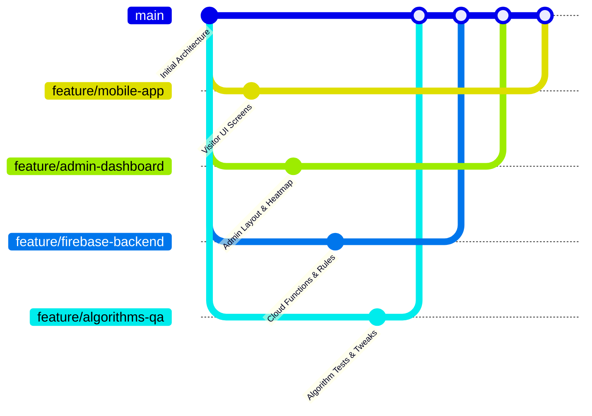

# QueueLess Development Guide

This guide describes how the four development team members work collaboratively on QueueLess without file conflicts or configuration mismatches.

---

## 1. Quick Start & Prerequisites

- **Node.js:** v18.0.0 or higher (v20+ recommended)
- **Package Manager:** `npm` (workspaces enabled)
- **Firebase CLI:** `npm install -g firebase-tools`
- **Expo CLI:** `npm install -g expo-cli` (or use `npx expo`)

### Repository Setup
```bash
# Clone the repository
git clone https://github.com/YourOrg/QueueLess.git
cd QueueLess

# Install all workspace dependencies
npm install
```

---

## 2. Four-Member Git Branching Strategy

To keep parallel development clean, each developer works on their designated feature branch branched from `main`:



### Recommended Branches
1. **Member 1 (Mobile):** `feature/mobile-app`
2. **Member 2 (Admin Dashboard):** `feature/admin-dashboard`
3. **Member 3 (Backend):** `feature/firebase-backend`
4. **Member 4 (Algorithms & QA):** `feature/algorithms-qa`

### Rules of Collaboration
- Never modify files in `shared/types/` without team consensus.
- If a new property is needed, propose it via a pull request to `shared/`.
- Frontend developers (`mobile` & `admin`) consume models and functions strictly from `@queueless/shared`.

---

## 3. Running Independent Modules

### 3.1 Shared Library
To compile and check types across the shared core:
```bash
npm run build -w shared
# or run in shared directory
cd shared && npm run build
```

### 3.2 Member 1 — Mobile Visitor App
```bash
cd mobile
npm install
npm run start
# For Android emulator
npm run android
# For iOS simulator (macOS only)
npm run ios
# For web preview
npm run web
```

### 3.3 Member 2 — Admin Web Dashboard
```bash
cd admin
npm install
npm run dev
# Dashboard launches at http://localhost:5173
```

### 3.4 Member 3 — Firebase Backend & Emulators
```bash
cd firebase
# Start local Firestore & Functions emulators
firebase emulators:start
```

### 3.5 Member 4 — Algorithms & QA Testing
```bash
npm test
# Run unit tests only
npm run test:unit
# Run integration tests only
npm run test:integration
```

---

## 4. Environment Variables Configuration

Copy `.env.example` in each directory to `.env.local` or `.env`:
- **Root:** `.env.example`
- **Admin:** `admin/.env.example`
- **Mobile:** `mobile/.env.example`
- **Firebase Functions:** `firebase/functions/.env.example`

*Note: Never commit `.env` or `.env.local` files containing live credentials to version control.*
